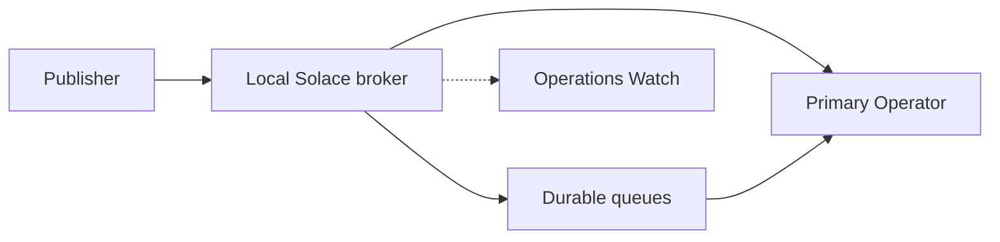
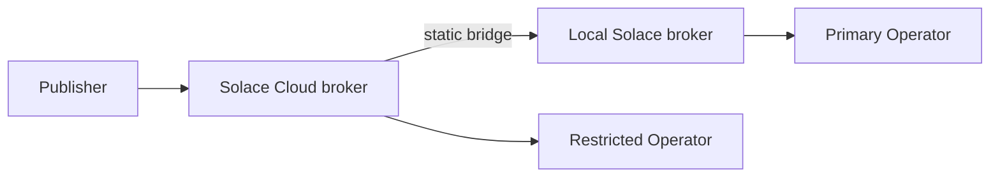

# Solace federal demo

A working example of Solace event routing, access control, and guaranteed delivery, built around an unclassified satellite-alert scenario. The repository includes a local broker lab you can run, a 10-slide presentation, and recorded walkthroughs of the presenter demos.

The alerts are example, unclassified data.

## Architecture

The default lab is a single Solace software broker on your machine. A publisher and an operator connect to it over SMF. Direct messages are delivered only while a consumer is subscribed. Guaranteed messages wait on a durable queue until the consumer reconnects.



An optional two-broker path, used in some of the recorded walkthroughs, publishes to a Solace Cloud broker and delivers events to the local broker over a static bridge. The Restricted Operator connects to Solace Cloud to show topic permissions.



## Connections

The table lists each connection this lab uses. Replace the placeholders with values from your brokers, and keep real hosts and passwords in a local env file. Variable lists and setup steps are in [demo/SPLIT-CLIENT.md](demo/SPLIT-CLIENT.md), [demo/MQTT-WEATHER.md](demo/MQTT-WEATHER.md), [demo/PERMISSIONS-DEMO.md](demo/PERMISSIONS-DEMO.md), [demo/AGENT-MESH.md](demo/AGENT-MESH.md), and [deploy/vm-publisher/](deploy/vm-publisher/).

The default single-broker lab uses the local SMF rows and the browser row. The optional two-broker path, used in the recorded walkthroughs, adds the Cloud publisher, MQTT weather, static bridge, and Restricted Operator rows. The Agent Mesh bonus adds the last two rows.

| Connection | Connects to | Protocol | Host:port | Login | Purpose |
| --- | --- | --- | --- | --- | --- |
| Browser | Python web app | HTTP | `http://127.0.0.1:8877` (`SOLACE_WEB_PORT`) | — | Demo pages at `/publisher`, `/operator`, and `/restricted-operator`. The browser does not connect to a Solace broker. |
| Publisher (default lab) | Local Solace broker | SMF | `tcp://127.0.0.1:55554` (`SOLACE_HOST`) | `ssa-publisher` (`SOLACE_PUBLISHER_USERNAME`) | Launch alerts, heartbeats, and guaranteed alerts on the single-broker lab. |
| Primary Operator | Local Solace broker | SMF | `tcp://127.0.0.1:55554` (`SOLACE_HOST`, or `SOLACE_OPERATOR_HOST` on the two-broker path) | `ssa-subscriber` (`SOLACE_SUBSCRIBER_USERNAME`), or `SOLACE_OPERATOR_USERNAME` | Receives matching Direct and Guaranteed events, including weather, over SMF. |
| Publisher, SMF (two-broker path) | Solace Cloud broker | SMF over TLS | `tcps://<cloud-host>:55443` (`SOLACE_PUBLISHER_HOST`) | `<publisher-client>` (`SOLACE_PUBLISHER_USERNAME`) | Launch alerts, heartbeats, and guaranteed alerts. |
| Publisher, MQTT weather | Broker in `SOLACE_MQTT_URL` | MQTT over TLS | `mqtts://<cloud-host>:8883` (`SOLACE_MQTT_URL`) | `<client>` (`SOLACE_MQTT_USERNAME`) | Optional simulated weather (`SOLACE_MQTT_WEATHER=1`). One QoS 0 reading per button press. |
| Static bridge `to-cloud-unclass` | Solace Cloud broker, initiated from the local broker | SMF over TLS (Message VPN bridge) | `<cloud-host>:55443` | A Cloud client username you create for the bridge | Direct traffic for remote subscription `ssa/>`. Also consumes Cloud queue `queue-cloud-guaranteed`. |
| Restricted Operator | Solace Cloud broker | SMF over TLS | `tcps://<cloud-host>:55443` (from `SOLACE_PERMISSIONS_CONFIG`) | Example: `client-cloud-permissions-demo` | Demo 2 permissions client, assigned to ACL profile `acl-cloud-permissions-demo`. |
| Agent Mesh (`sam-bonus-mesh`) | Local Solace broker | SMF | `tcp://localhost:55554` (or the SMF port you published) | `sam-bonus-mesh` | Bonus Operations Watch agents, under namespace `ssa-bonus-mesh/`. |
| Operations Watch, SEMP | Local Broker Manager | HTTP (SEMP) | `SOLACE_OPERATOR_SEMP_URL` (local default `http://127.0.0.1:8080`) | `OPS_WATCH_SEMP_USERNAME` (a read-only SEMP user) | Read-only queue depth and operator bind state. This monitor does not use the admin login. |

The local broker container, started with `docker compose -p solace-ssa-demo up -d`, publishes two host ports on loopback: `SOLACE_SMF_PORT` (default 55554) to container SMF port 55555, and `SOLACE_SEMP_PORT` (default 8080) to Broker Manager and SEMP at container port 8080. Use the same host port numbers in `SOLACE_HOST` and `SOLACE_SEMP_URL`.

55443 (SMF over TLS) and 8883 (MQTT over TLS) are Solace Cloud's standard TLS ports. See [Default Port Numbers](https://docs.solace.com/Admin/Default-Port-Numbers.htm). Loopback `mqtt://` is accepted for weather only on `127.0.0.1`, `localhost`, or `::1`.

The example publisher service in [deploy/vm-publisher/](deploy/vm-publisher/) is the same Publisher process, served at `http://<host>:<port>/publisher`, and uses the Solace Cloud publisher and MQTT variables above.

## Topic structure

Events in this demo use a six-level topic:

`ssa/<classification>/<site>/<category>/<object>/<event>`

| Level | Meaning | Examples |
| --- | --- | --- |
| Root | Shared topic root for this demo | `ssa` |
| Classification | Handling label | `unclass` |
| Site | Ground site | `ground1`, `ground2` |
| Category | Kind of event | `launch`, `status`, `live`, `weather` |
| Object | The subject of the event | `25544`, `station-1` |
| Event | Leaf type | `alert`, `heartbeat`, `update`, `reading` |

Examples used by the lab:

- `ssa/unclass/ground1/launch/25544/alert`
- `ssa/unclass/ground2/status/25544/heartbeat`
- `ssa/unclass/ground1/live/25544/update`
- `ssa/unclass/ground1/weather/station-1/reading`, where the object is a weather station rather than a satellite identifier

Subscriptions use `*` for one level and `>` for one or more levels at the end. The Primary Operator in Demo 1 uses both:

- `ssa/unclass/*/launch/>` — launch alerts from any ground site
- `ssa/unclass/ground1/*/25544/>` — every event for object 25544 at Ground 1

On the optional two-broker path, Guaranteed messages use a separate topic tree so they do not ride the Direct bridge subscription `ssa/>`. The configured prefix is `ssa-guaranteed/unclass` in place of `ssa/unclass`, so the same launch alert is published as `ssa-guaranteed/unclass/ground1/launch/25544/alert`. In the single-broker lab, that prefix is left unset and Guaranteed alerts stay on `ssa/unclass/...`.

## Prerequisites

- Python 3.9 or newer
- Docker
- For the optional two-broker path: a Solace Cloud service and the client credentials you create on it
- For the bonus Agent Mesh demo: Solace Agent Mesh and a Gemini API key, as described in [demo/AGENT-MESH.md](demo/AGENT-MESH.md)

Broker passwords and client credentials stay in local env files. Copy [demo/.env.example](demo/.env.example) to `demo/.env` and replace the `CHANGE_ME` values.

## Quick start

```bash
cd demo
python3 -m venv .venv
source .venv/bin/activate
python -m pip install -r requirements.txt
cp .env.example .env
```

Edit `demo/.env` and set the local admin, publisher, and subscriber passwords. If host ports 8080 or 55554 are already in use, set `SOLACE_SEMP_PORT` and `SOLACE_SMF_PORT` to free ports and use the same values in `SOLACE_SEMP_URL` and `SOLACE_HOST`.

```bash
docker compose -p solace-ssa-demo up -d
python -m solace_demo prereqs
python -m solace_demo wait
python -m solace_demo quickstart
python -m solace_demo web
```

`python -m solace_demo config-check` prints the host, SEMP URL, VPN, and whether each password key is set.

Open the pages (default port 8877, or `SOLACE_WEB_PORT` if you set one):

- http://127.0.0.1:8877/publisher
- http://127.0.0.1:8877/operator
- http://127.0.0.1:8877/restricted-operator

Broker Manager for the local Solace broker is http://127.0.0.1:8080 (or your `SOLACE_SEMP_PORT`).

`quickstart` runs the three command-line scenarios: topic routing, access control, and guaranteed delivery. Click-by-click presenter steps are in [docs/DEMO-QUICK-REFERENCE.md](docs/DEMO-QUICK-REFERENCE.md). To stop the lab: `docker compose -p solace-ssa-demo down`.

The two-broker and Agent Mesh setups are documented in [demo/README.md](demo/README.md), [demo/SPLIT-CLIENT.md](demo/SPLIT-CLIENT.md), and [demo/AGENT-MESH.md](demo/AGENT-MESH.md).

## Configuration

All connection settings use environment variables. See [Connections](#connections) for a compact list of each session and its placeholders. The local lab reads `demo/.env`. Optional two-broker, permissions, and MQTT settings are listed (commented out) in `.env.example` and described in the demo docs. Point `SOLACE_DOTENV_PATH` at a separate file if you want to keep Cloud credentials out of the local-lab env file.

Optional `SOLACE_CLIENT_NAME` sets the publisher SMF client name shown in Broker Manager. When it is unset, the Solace API auto-generates a name. Two publisher sessions that use the same client name will disconnect each other.

## Tests

```bash
cd demo
source .venv/bin/activate
python -m pip install -r requirements-dev.txt
python -m pytest
```

Topic matching, ACL behavior, configuration checks, and the web-page tests run without a broker. `tests/test_broker_integration.py` runs when the lab is up and the passwords in `.env` are set; otherwise it is skipped. GitHub Actions runs the local-broker suite on each pull request; the optional Cloud job is described in [demo/CI.md](demo/CI.md).

## Repository layout

| Path | Contents |
| --- | --- |
| [demo/](demo/) | Local broker lab, web pages, tests, and Agent Mesh bonus files |
| [docs/DEMO-QUICK-REFERENCE.md](docs/DEMO-QUICK-REFERENCE.md) | Presenter steps for each recorded demo |
| [presentation/](presentation/) | HTML deck, PDF, and speaker notes |
| [source/](source/) | Deck generator, SVG slides, and rebuild notes |
| [deploy/vm-publisher/](deploy/vm-publisher/) | Example systemd unit for a remote publisher process |

## Demos and videos

Silent review recordings are on the [v1.0](https://github.com/Austinreedthomas/solace-federal-demo/releases/tag/v1.0) GitHub Release.

| Demo | Purpose | Length | Video | Steps |
| --- | --- | --- | --- | --- |
| Demo 1 — Topic routing and live (Direct) delivery | One publish reaches every application whose interest matches. | 2:53 | [MP4](https://github.com/Austinreedthomas/solace-federal-demo/releases/download/v1.0/demo1-topic-routing-and-direct.mp4) | [Steps](docs/DEMO-QUICK-REFERENCE.md#demo-1-topic-routing-and-live-direct-delivery) |
| Demo 2 — Restricted client permissions | The Solace Cloud broker decides what a signed-in client may publish and subscribe to. | 2:21 | [MP4](https://github.com/Austinreedthomas/solace-federal-demo/releases/download/v1.0/demo2-restricted-client-permissions.mp4) | [Steps](docs/DEMO-QUICK-REFERENCE.md#demo-2-restricted-client-permissions) |
| Demo 3 — Guaranteed delivery from a Solace Cloud broker to the local Solace broker | A Guaranteed alert waits in the queue on the local Solace broker while the operator is paused, then arrives tagged Queued when receiving resumes. | 2:26 | [MP4](https://github.com/Austinreedthomas/solace-federal-demo/releases/download/v1.0/demo3-guaranteed-offline-recovery.mp4) | [Steps](docs/DEMO-QUICK-REFERENCE.md#demo-3-guaranteed-delivery-from-a-solace-cloud-broker-to-the-local-solace-broker) |
| Bonus — Agent Mesh observes the primary operator | Operations Watch reports which guaranteed alerts queued while the primary operator was disconnected, and confirms delivery after reconnect. | 1:33 | [MP4](https://github.com/Austinreedthomas/solace-federal-demo/releases/download/v1.0/demo4-ops-watch.mp4) | [Steps](docs/DEMO-QUICK-REFERENCE.md#bonus-agent-mesh-observes-the-primary-operator) |

## Presentation

Download [presentation/index.html](presentation/index.html) and open it in a browser. It is self-contained and works offline.

| File | What it is |
| --- | --- |
| [presentation/index.html](presentation/index.html) | The 10-slide deck |
| [presentation/solace-federal-deck.pdf](presentation/solace-federal-deck.pdf) | 10-page landscape PDF |
| [presentation/SPEAKER-NOTES.md](presentation/SPEAKER-NOTES.md) | Speaker notes and public sources |
| [source/BUILD.md](source/BUILD.md) | How to rebuild the deck from `source/` |

Navigation: Left / Right, Page Up / Page Down, Home, End. Press **N** for speaker notes. A URL hash such as `#5` selects that slide. Ctrl/Cmd+P prints 10 landscape pages with notes hidden.

### Deck order

1. Get satellite alerts to the right people on the ground.
2. Outcomes, including alerts that wait when an operator or system is offline.
3. Launch-detected example flow.
4. Solace delivery between the feed and the operator.
5. Controlled access.
6. Offline queues for an operator or system.
7. Kafka keeps history; Solace distributes alerts. The footer is “Kafka retains event history. Solace distributes alerts.”
8. Core broker demonstration first. Optional Agent Mesh AI is last.
9. Federal concern, approach, and what to prove, including the ATO note and the official retention link.
10. Prove the business value in your environment.

Pitch length is about 20–30 minutes, plus a 5–10 minute demo at slide 8.

### Rebuild from source

Present from `presentation/`. A rebuild is optional.

```bash
cd source
python3 -m venv .venv
.venv/bin/pip install -r requirements-render.txt
.venv/bin/python deck/build_deck.py
```

The script reads `start.html`, `assets/`, `notes/preserved-notes.json`, and `deck/slide-01.svg` through `slide-10.svg`. Slides 3, 6, and 7 are drawn by `build_deck.py`, which also writes `slide-03.svg`, `slide-06.svg`, and `slide-07.svg`. The run needs Python 3 and the Cairo library. Leave `presentation/index.html` and `presentation/solace-federal-deck.pdf` as the files to open.
